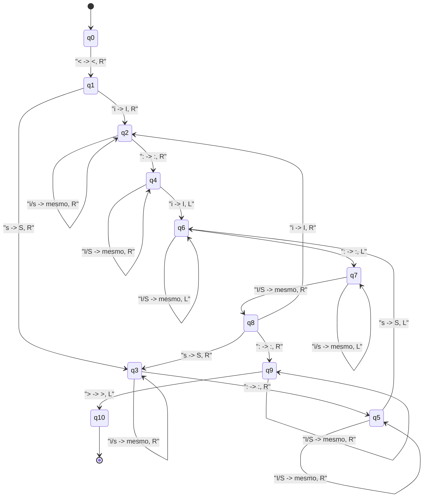

# Autômato Linearmente Limitado Determinístico (ALL — MiniSemantic, 11 estados)

## Tabela completa de transições (δ_ALL)

| Origem | Lê | Destino | Escreve | Movimento |
| :--- | :---: | :--- | :---: | :---: |
| `q0` | `<` | `q1` | `<` | `R` |
| `q1` | `i` | `q2` | `I` | `R` |
| `q1` | `s` | `q3` | `S` | `R` |
| `q2` | `i` | `q2` | `i` | `R` |
| `q2` | `s` | `q2` | `s` | `R` |
| `q2` | `:` | `q4` | `:` | `R` |
| `q3` | `i` | `q3` | `i` | `R` |
| `q3` | `s` | `q3` | `s` | `R` |
| `q3` | `:` | `q5` | `:` | `R` |
| `q4` | `I` | `q4` | `I` | `R` |
| `q4` | `S` | `q4` | `S` | `R` |
| `q4` | `i` | `q6` | `I` | `L` |
| `q5` | `I` | `q5` | `I` | `R` |
| `q5` | `S` | `q5` | `S` | `R` |
| `q5` | `s` | `q6` | `S` | `L` |
| `q6` | `I` | `q6` | `I` | `L` |
| `q6` | `S` | `q6` | `S` | `L` |
| `q6` | `:` | `q7` | `:` | `L` |
| `q7` | `i` | `q7` | `i` | `L` |
| `q7` | `s` | `q7` | `s` | `L` |
| `q7` | `I` | `q8` | `I` | `R` |
| `q7` | `S` | `q8` | `S` | `R` |
| `q8` | `i` | `q2` | `I` | `R` |
| `q8` | `s` | `q3` | `S` | `R` |
| `q8` | `:` | `q9` | `:` | `R` |
| `q9` | `I` | `q9` | `I` | `R` |
| `q9` | `S` | `q9` | `S` | `R` |
| `q9` | `>` | `q10` | `>` | `L` |
