# Autômato de Pilha Determinístico (AP — MiniParser, 9 estados)

```mermaid
stateDiagram-v2
    direction LR
    [*] --> q0
    q0 --> q1: "p, Z / Z"
    q1 --> q2: "{, Z / {Z"
    q2 --> q2: "{, { / {{ | {, ( / {( | (, { / ({ | (, ( / (( | }, { / ε | ), ( / ε"
    q2 --> q3: "ε, Z / Z"
    q3 --> q4: "#, Z / Z"
    q4 --> q5: "i, Z / Z | s, Z / Z"
    q5 --> q5: "i, Z / Z | s, Z / Z"
    q5 --> q6: ":, Z / Z"
    q6 --> q7: "i, Z / Z | s, Z / Z"
    q7 --> q7: "i, Z / Z | s, Z / Z"
    q7 --> q8: ";, Z / Z"
    q8 --> [*]
```

## Tabela completa de transições (δ_AP)

| Origem | Leitura | Desempilha | Destino | Empilha |
| :--- | :---: | :---: | :--- | :---: |
| `q0` | `p` | `Z` | `q1` | `Z` |
| `q1` | `{` | `Z` | `q2` | `{Z` |
| `q2` | `{` | `{` | `q2` | `{{` |
| `q2` | `{` | `(` | `q2` | `{(` |
| `q2` | `(` | `{` | `q2` | `({` |
| `q2` | `(` | `(` | `q2` | `((` |
| `q2` | `}` | `{` | `q2` | `ε` |
| `q2` | `)` | `(` | `q2` | `ε` |
| `q2` | `ε` | `Z` | `q3` | `Z` |
| `q3` | `#` | `Z` | `q4` | `Z` |
| `q4` | `i` | `Z` | `q5` | `Z` |
| `q4` | `s` | `Z` | `q5` | `Z` |
| `q5` | `i` | `Z` | `q5` | `Z` |
| `q5` | `s` | `Z` | `q5` | `Z` |
| `q5` | `:` | `Z` | `q6` | `Z` |
| `q6` | `i` | `Z` | `q7` | `Z` |
| `q6` | `s` | `Z` | `q7` | `Z` |
| `q7` | `i` | `Z` | `q7` | `Z` |
| `q7` | `s` | `Z` | `q7` | `Z` |
| `q7` | `;` | `Z` | `q8` | `Z` |
